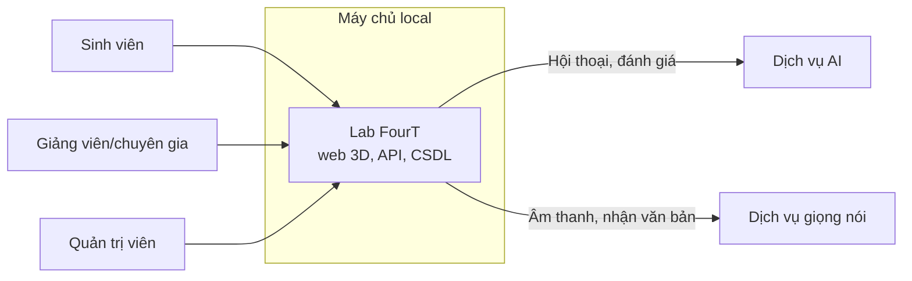

# 01. Tổng quan

## 1. Mục đích

Tài liệu này mô tả những gì bản đầu của Lab FourT phải làm được, làm căn cứ để thiết kế, phát triển, kiểm thử và nghiệm thu. Tài liệu không thay thế tài liệu định hướng gốc về mặt sư phạm, mà chuyển nó thành yêu cầu có thể kiểm chứng.

## 2. Mô tả sản phẩm

Sinh viên đóng vai người tham vấn. AI đóng vai thân chủ trong một tình huống có bối cảnh, nhân vật và mục tiêu học tập rõ ràng. Người học vào phòng tham vấn 3D, trao đổi với thân chủ, rồi xem transcript và báo cáo để tự nhìn lại quá trình thực hành.

Đây là môi trường mô phỏng phục vụ học tập. AI không phải thân chủ thật, không thay thế chuyên gia và không kết luận về năng lực nghề nghiệp của sinh viên.

## 3. Phạm vi bản đầu

### 3.1. Trong phạm vi

| Nhóm | Nội dung |
|---|---|
| Tài khoản | Đăng nhập, phân quyền theo vai trò, quản lý lớp/nhóm |
| Nội dung | Thư viện ca, 3 ca mẫu, tạo và chỉnh sửa ca, giao bài |
| Thực hành | Phòng tham vấn 3D, chế độ nhẹ 2D, trao đổi bằng giọng nói hoặc văn bản, AI phản hồi bằng văn bản |
| Sau phiên | Transcript, báo cáo theo rubric, phản tư, nộp bài |
| Giảng viên | Theo dõi tiến độ, xem kết quả, bổ sung nhận xét, thống kê theo kỹ năng |
| Dữ liệu | Xóa mềm, quản lý bằng trạng thái, nhật ký kiểm toán, sao lưu |
| Vận hành | Trang quản trị, triển khai trên máy chủ local |

### 3.2. Ngoài phạm vi

| Nội dung | Ghi chú |
|---|---|
| Kính VR, WebXR | Giai đoạn sau. Kiến trúc không được chặn hướng này (D-02) |
| AI phản hồi bằng giọng nói | Không có trong bản đầu, nên không có khớp môi (D-05) |
| Xây dựng mô hình AI, nhận dạng giọng nói | Đầu mối AI/giọng nói phụ trách (D-07) |
| Dùng điểm AI làm điểm học phần | Điểm AI chỉ để tự đánh giá và tham khảo (D-08) |
| Theo dõi tiến bộ qua nhiều phiên ở mức nâng cao | Giai đoạn sau |
| Đăng nhập bằng tài khoản trường (SSO) | Giai đoạn sau |
| Cung cấp dịch vụ tham vấn, chẩn đoán, điều trị thật | Không thuộc mục tiêu sản phẩm |

## 4. Tác nhân

| Tác nhân | Mô tả | Việc chính |
|---|---|---|
| Sinh viên | Người học đóng vai người tham vấn | Chọn ca, thực hành, xem báo cáo, viết phản tư, nộp bài |
| Giảng viên/chuyên gia | Người thiết kế ca và hướng dẫn | Tạo ca, giao bài, xem kết quả, nhận xét |
| Quản trị viên | Nhóm khởi nghiệp và người phụ trách IT | Quản lý tài khoản, trạng thái dữ liệu, cấu hình, theo dõi hệ thống |
| Dịch vụ AI | Hệ thống ngoài | Đóng vai thân chủ, đề xuất đánh giá |
| Dịch vụ giọng nói (STT) | Hệ thống ngoài | Chuyển lời nói thành văn bản |

Quản trị viên có thể không có nền tảng kỹ thuật, nên các thao tác thường ngày phải làm được trên giao diện.

## 5. Sơ đồ ngữ cảnh

Dịch vụ AI và STT có chạy trên cùng máy chủ hay không chưa được xác định (OI-05).

## 6. Môi trường vận hành

| Hạng mục | Mô tả |
|---|---|
| Người dùng | 50 tài khoản, gồm cả giảng viên và sinh viên |
| Thiết bị | Máy tính, iPad, điện thoại |
| Trình duyệt | Trình duyệt phổ biến, không cài ứng dụng |
| Máy chủ | Chạy local, do người phụ trách IT quản lý |
| Mạng | Mạng nội bộ là giả định hiện tại, chưa xác định có truy cập từ xa hay không (OI-04) |

## 7. Ràng buộc

| Mã | Ràng buộc | Lý do |
|---|---|---|
| C-01 | Phải có phòng 3D ngay trong bản đầu | Là trọng tâm dự án (D-01) |
| C-02 | Website phải chạy qua HTTPS, kể cả trên mạng nội bộ | Trình duyệt chỉ cấp quyền micro trong ngữ cảnh an toàn, `http://<IP nội bộ>` sẽ không dùng được giọng nói |
| C-03 | Mọi tài nguyên phải tự lưu trữ trên máy chủ local | Hệ thống phải chạy được khi không có internet |
| C-04 | Khóa bí mật của dịch vụ AI chỉ nằm ở máy chủ | Yêu cầu bảo mật của tài liệu gốc |
| C-05 | Điểm và đánh giá chỉ được tạo, xác minh ở máy chủ | Không tin dữ liệu từ trình duyệt |
| C-06 | Không tự động xóa vĩnh viễn dữ liệu phiên | Quyết định D-04 |

## 8. Giả định và phụ thuộc

| Mã | Nội dung | Nếu sai thì sao |
|---|---|---|
| A-01 | Đầu mối AI/giọng nói cung cấp dịch vụ theo hợp đồng tại tài liệu 07, hoặc thống nhất hợp đồng khác | Phải điều chỉnh lớp kết nối ở backend, các phần khác không đổi |
| A-02 | Người dùng truy cập trong cùng mạng với máy chủ | Phải bổ sung phương án truy cập từ xa an toàn |
| A-03 | Giảng viên cung cấp và thẩm định nội dung ca, rubric | Không nghiệm thu được nội dung ca |
| A-04 | Có phòng và nhân vật 3D, tự làm hoặc từ nguồn đúng giấy phép | Trễ hạng mục phòng 3D (OI-10) |
| A-05 | Mô hình AI chấp nhận lịch sử hội thoại do backend gửi ở mỗi lượt | Phải đổi cách quản lý trạng thái hội thoại |

## 9. Thuật ngữ

| Thuật ngữ | Ý nghĩa |
|---|---|
| Ca (case) | Một tình huống mô phỏng với hồ sơ thân chủ và mục tiêu học tập |
| Phiên (session) | Một lần sinh viên thực hành một ca |
| Lượt (turn) | Một lần trao đổi: lời sinh viên và phản hồi của thân chủ AI |
| Transcript | Bản ghi văn bản toàn bộ hội thoại của phiên |
| Rubric | Bộ tiêu chí đánh giá kỹ năng với thang 4 mức |
| Phản tư | Phần sinh viên tự nhìn lại sau khi xem báo cáo |
| STT | Speech-to-Text, chuyển lời nói thành văn bản |
| Chế độ nhẹ | Giao diện 2D thay cho phòng 3D khi thiết bị không chạy tốt |
| Xóa mềm | Ẩn dữ liệu bằng trạng thái, không xóa khỏi cơ sở dữ liệu |
| RBAC | Phân quyền theo vai trò |
