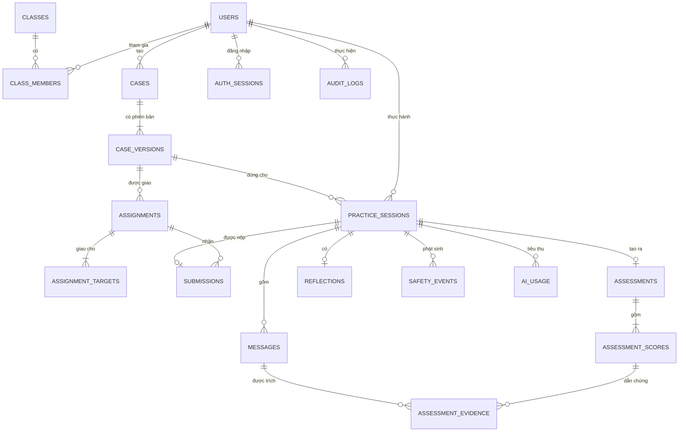
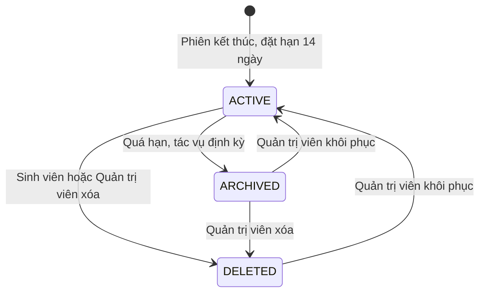
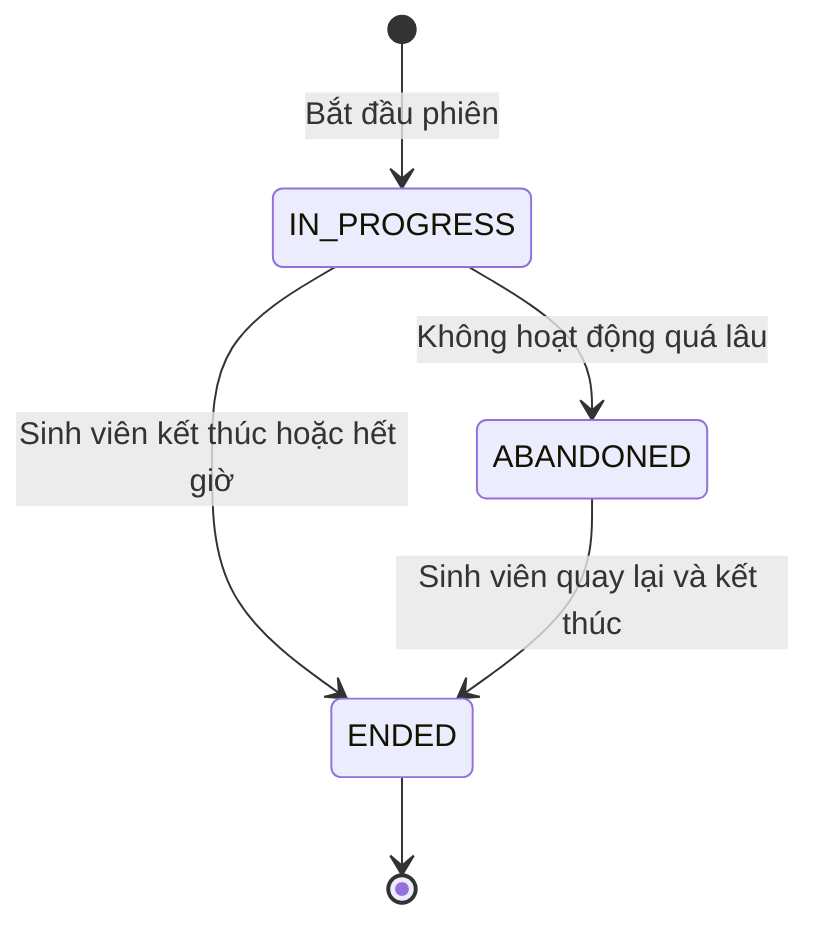
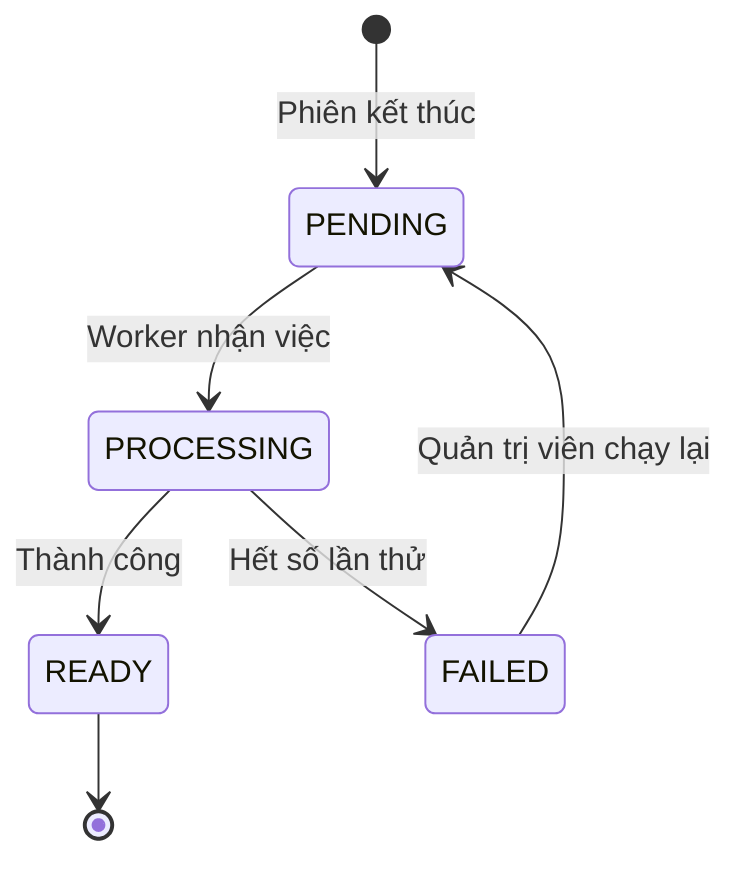

# 04. Mô hình dữ liệu

## 1. Sơ đồ quan hệ



## 2. Thực thể

Mọi bảng dùng khóa chính UUID và có `created_at`, `updated_at`, trừ các bảng chỉ ghi thêm.

| Bảng | Vai trò | Trường chính |
|---|---|---|
| `users` | Tài khoản | `username`, `full_name`, `password_hash`, `role`, `status`, `must_change_password`, `last_login_at` |
| `auth_sessions` | Phiên đăng nhập | `user_id`, `token_hash`, `expires_at`, `revoked_at` |
| `classes` | Lớp hoặc nhóm | `name`, `term`, `status` |
| `class_members` | Thành viên lớp | `class_id`, `user_id`, `member_role` |
| `cases` | Thông tin ca | `title`, `status`, `owner_id`, `current_version_id` |
| `case_versions` | Phiên bản không đổi của ca | `case_id`, `version_no`, `profile` (JSONB), `rubric` (JSONB), `difficulty`, `skills`, `max_duration_min`, `avatar_key`, `content_review_status`, `published_at` |
| `assignments` | Bài được giao | `case_version_id`, `created_by`, `title`, `due_at`, `status` |
| `assignment_targets` | Đối tượng được giao | `assignment_id`, `target_type`, `class_id`, `user_id` |
| `practice_sessions` | Phiên thực hành | `user_id`, `case_version_id`, `assignment_id`, `status`, `render_mode`, `client_state` (JSONB), `started_at`, `ended_at`, `last_activity_at`, `record_status`, `retention_until`, `deleted_at`, `deleted_by` |
| `messages` | Từng lời trong hội thoại | `session_id`, `seq`, `speaker`, `content`, `input_mode`, `stt_confidence`, `stt_edited`, `emotion`, `client_turn_id` |
| `assessments` | Báo cáo sau phiên | `session_id`, `status`, `summary`, `strengths`, `improvements`, `reflection_questions`, `practice_goals`, `limitation_note`, `ai_version`, `lecturer_comment`, `reviewed_by`, `reviewed_at` |
| `assessment_scores` | Đánh giá từng kỹ năng | `assessment_id`, `skill_code`, `ai_level`, `ai_rationale`, `lecturer_level`, `lecturer_note`, `needs_review` |
| `assessment_evidence` | Dẫn chứng | `score_id`, `message_id`, `quote`, `verified` |
| `reflections` | Phản tư | `session_id`, `answers` (JSONB), `next_goal`, `submitted_at` |
| `submissions` | Bài nộp | `assignment_id`, `session_id`, `student_id`, `status`, `is_late`, `submitted_at` |
| `safety_events` | Sự kiện an toàn | `session_id`, `message_id`, `level`, `handling_status`, `handled_by`, `note` |
| `ai_usage` | Mức dùng AI, STT | `session_id`, `kind`, `model`, `input_tokens`, `output_tokens`, `audio_seconds`, `latency_ms`, `outcome`, `estimated_cost` |
| `audit_logs` | Nhật ký kiểm toán, chỉ ghi thêm | `actor_id`, `action`, `entity_type`, `entity_id`, `before`, `after`, `ip`, `created_at` |
| `system_settings` | Tham số hệ thống | `key`, `value`, `updated_by` |

Ràng buộc quan trọng:

- `messages` có khóa duy nhất trên (`session_id`, `seq`) và (`session_id`, `client_turn_id`). Khóa thứ hai giúp gửi lại không tạo lượt trùng.
- `case_versions` không được sửa sau khi xuất bản.
- `assessment_scores.ai_level` chỉ do backend ghi. Giảng viên chỉ ghi `lecturer_level` và `lecturer_note`.
- Không có bảng nào lưu âm thanh.

### 2.1. Mã kỹ năng

| Mã | Kỹ năng |
|---|---|
| `ACTIVE_LISTENING` | Lắng nghe chủ động |
| `OPEN_QUESTIONS` | Câu hỏi mở và làm rõ |
| `EMPATHY` | Thấu cảm và phản hồi cảm xúc |
| `SUMMARIZING` | Tóm tắt và xác định vấn đề |
| `AUTONOMY` | Tôn trọng quyền tự quyết |
| `ETHICS_SAFETY` | Đạo đức và an toàn |

Thang mức: 1 Chưa thể hiện, 2 Đang hình thành, 3 Đạt yêu cầu, 4 Thể hiện linh hoạt trong mô phỏng. `null` nghĩa là chưa đủ dữ liệu.

## 3. Xóa mềm và thời hạn 14 ngày

Quyết định D-04: dữ liệu không bị xóa hẳn sau 14 ngày. Hệ thống dùng trạng thái để quản lý.

`record_status` nằm ở `practice_sessions`. Transcript, báo cáo, phản tư và dẫn chứng đi theo phiên, không có trạng thái riêng.

| Giá trị | Ý nghĩa |
|---|---|
| `ACTIVE` | Đang hiệu lực, hiển thị bình thường |
| `ARCHIVED` | Đã lưu trữ do quá hạn, ẩn với sinh viên và giảng viên |
| `DELETED` | Đã xóa mềm, ẩn với sinh viên và giảng viên |



| `record_status` | Sinh viên | Giảng viên | Quản trị viên |
|---|---|---|---|
| `ACTIVE` | Xem, xóa | Xem theo phạm vi | Xem, đổi trạng thái |
| `ARCHIVED` | Không thấy | Chỉ số liệu tổng hợp | Xem, đổi trạng thái |
| `DELETED` | Không thấy | Không thấy | Xem, đổi trạng thái |

Quy tắc xử lý:

1. Khi phiên kết thúc hoặc bị bỏ dở, `retention_until` được đặt bằng thời điểm kết thúc cộng thời hạn cấu hình, mặc định 14 ngày.
2. Tác vụ chạy hằng ngày chuyển các phiên `ACTIVE` đã quá `retention_until` sang `ARCHIVED`.
3. Khi khôi phục, Quản trị viên phải đặt `retention_until` mới, nếu không tác vụ định kỳ sẽ lưu trữ lại phiên ngay.
4. Nếu sinh viên xóa một phiên đã nộp, bài nộp chuyển sang `WITHDRAWN` và giảng viên thấy "người học đã rút bài" (OI-12).
5. Mọi thay đổi trạng thái được ghi vào `audit_logs` (FR-DATA-06).
6. Mọi truy vấn của sinh viên và giảng viên phải lọc `record_status`. Việc lọc được đặt ở một lớp dùng chung để không bỏ sót.

Hệ quả: vì không có xóa vĩnh viễn, dữ liệu sẽ tồn tại vô thời hạn. Tài liệu gốc yêu cầu có "thời hạn lưu transcript và quy trình yêu cầu xóa dữ liệu", nên việc có cần thao tác xóa vĩnh viễn theo yêu cầu hay không được ghi tại OI-07.

## 4. Trạng thái khác

| Đối tượng | Trường | Giá trị |
|---|---|---|
| Tài khoản | `users.status` | `ACTIVE`, `LOCKED`, `DISABLED` |
| Ca | `cases.status` | `DRAFT`, `PUBLISHED`, `ARCHIVED` |
| Bài được giao | `assignments.status` | `OPEN`, `CLOSED`, `ARCHIVED` |
| Bài nộp | `submissions.status` | `SUBMITTED`, `WITHDRAWN` |
| Sự kiện an toàn | `safety_events.handling_status` | `NEW`, `ACKNOWLEDGED`, `CLOSED` |

Tài khoản không bị xóa khỏi CSDL. Vô hiệu hóa tài khoản giữ nguyên lịch sử, thu hồi phiên đăng nhập và chặn đăng nhập.

### 4.1. Trạng thái phiên thực hành



### 4.2. Trạng thái báo cáo



## 5. Hồ sơ ca

`case_versions.profile` được lưu dưới dạng JSONB, vì cấu trúc còn thay đổi theo góp ý của giảng viên. Backend kiểm tra theo lược đồ trước khi xuất bản.

```json
{
  "background": "Thông tin nền của thân chủ",
  "mainIssue": "Điều khiến thân chủ tìm kiếm hỗ trợ",
  "learningObjectives": ["Lắng nghe", "Làm rõ vấn đề"],
  "persona": { "traits": ["dè dặt", "lo lắng"], "speechStyle": "ít nói" },
  "hiddenInformation": [
    { "id": "h1", "content": "Chi tiết chưa chia sẻ", "unlockCondition": "Khi sinh viên hỏi mở về gia đình" }
  ],
  "emotionalArc": "Cách cảm xúc và mức độ sẵn sàng chia sẻ thay đổi",
  "safetyBoundaries": ["Điều AI không được tự suy diễn"],
  "assessmentCriteria": [
    { "skill": "ACTIVE_LISTENING", "observableBehaviors": ["Phản hồi đúng điều thân chủ nói"] }
  ]
}
```

## 6. Dữ liệu ban đầu

Hệ thống được khởi tạo với: một tài khoản Quản trị viên đầu tiên, 3 ca mẫu ở trạng thái Nháp cho đến khi giảng viên duyệt, rubric mặc định 6 kỹ năng, và tham số hệ thống mặc định.
