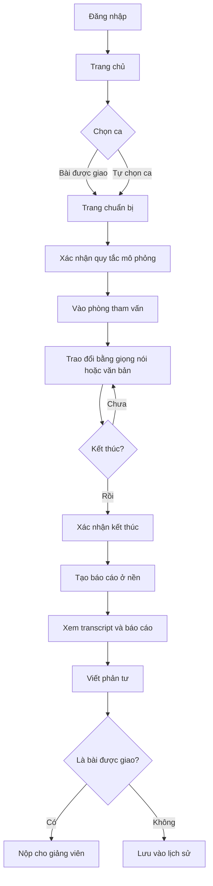
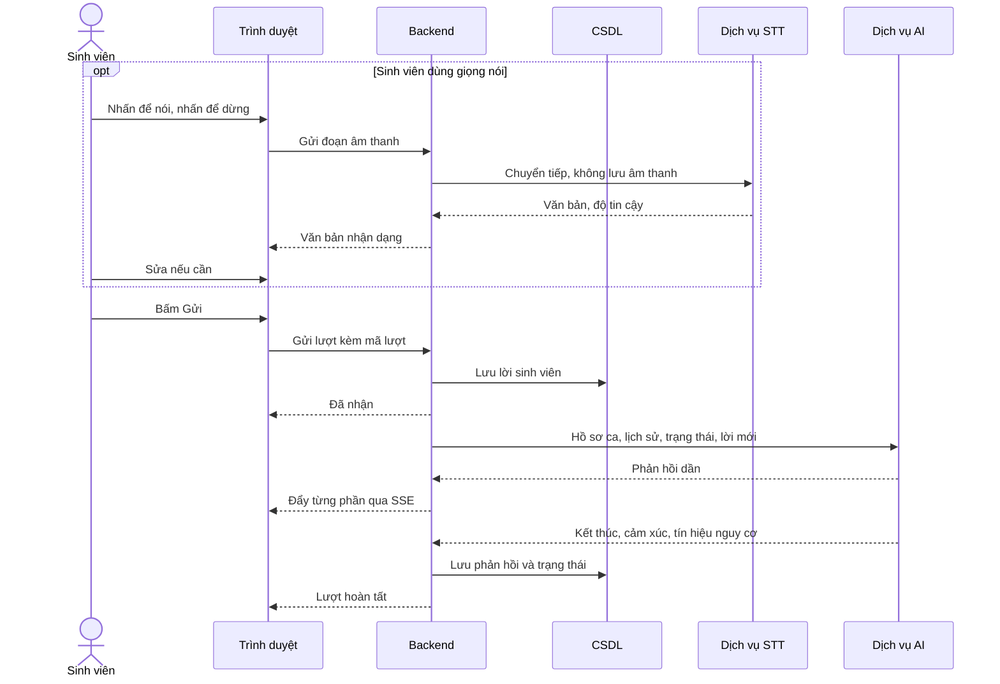

# 05. Giao diện và luồng nghiệp vụ

## 1. Danh sách màn hình

| Mã | Màn hình | Vai trò | Thành phần chính | Yêu cầu liên quan |
|---|---|---|---|---|
| SCR-01 | Đăng nhập | Tất cả | Tên đăng nhập, mật khẩu | FR-AUTH-01, FR-AUTH-06 |
| SCR-02 | Đổi mật khẩu | Tất cả | Mật khẩu cũ, mật khẩu mới | FR-AUTH-03 |
| SCR-03 | Trang chủ sinh viên | Sinh viên | Giới thiệu ngắn, nút thực hành, bài được giao, tiến độ, lịch sử | FR-ASG-02 |
| SCR-04 | Thư viện ca | Sinh viên, Giảng viên | Thẻ ca, bộ lọc | FR-CASE-01, FR-CASE-02 |
| SCR-05 | Trang chuẩn bị | Sinh viên | Bối cảnh, mục tiêu, vai trò, lưu ý, cảnh báo mô phỏng, nút Bắt đầu phiên | FR-CASE-03, FR-SES-01 |
| SCR-06 | Phòng tham vấn | Sinh viên | Không gian 3D, thân chủ, hội thoại, micro, ô nhập, trạng thái phiên, nút Kết thúc phiên | FR-3D, FR-CONV, FR-SES |
| SCR-07 | Báo cáo sau phiên | Sinh viên, Giảng viên | Rubric, dẫn chứng, điểm mạnh, điểm cần cải thiện, nhận xét giảng viên | FR-RPT, FR-LEC-04 |
| SCR-08 | Transcript | Sinh viên, Giảng viên | Hội thoại đầy đủ, liên kết từ dẫn chứng | FR-RPT-05, FR-RPT-08 |
| SCR-09 | Phản tư và nộp bài | Sinh viên | Câu hỏi phản tư, nút lưu nháp, nút nộp | FR-REF, FR-ASG-04 |
| SCR-10 | Lịch sử phiên | Sinh viên | Danh sách phiên, hạn còn lại, nút xóa | FR-DATA-02 |
| SCR-11 | Trang chủ giảng viên | Giảng viên | Lớp phụ trách, bài đang mở, bài chờ xem | FR-LEC-01 |
| SCR-12 | Soạn ca | Giảng viên | Biểu mẫu 8 thành phần, cấu hình, xem trước, xuất bản | FR-CASE-04 đến FR-CASE-08 |
| SCR-13 | Giao bài | Giảng viên | Chọn ca, đối tượng, hạn | FR-ASG-01 |
| SCR-14 | Tiến độ lớp | Giảng viên | Bảng sinh viên theo trạng thái | FR-LEC-01 |
| SCR-15 | Xem xét bài nộp | Giảng viên | Transcript, đánh giá AI, đánh giá giảng viên đặt cạnh nhau | FR-LEC-02, FR-LEC-03 |
| SCR-16 | Thống kê kỹ năng | Giảng viên | Phân bố mức theo kỹ năng của lớp | FR-LEC-05 |
| SCR-17 | Quản lý tài khoản | Quản trị viên | Danh sách, tạo, nhập CSV, khóa, đặt lại mật khẩu | FR-USR-01, FR-USR-02, FR-AUTH-04 |
| SCR-18 | Quản lý lớp | Quản trị viên, Giảng viên | Lớp, giảng viên, sinh viên | FR-USR-03, FR-USR-04 |
| SCR-19 | Quản lý dữ liệu phiên | Quản trị viên | Lọc theo trạng thái, đổi trạng thái, khôi phục | FR-DATA-04 |
| SCR-20 | Cấu hình | Quản trị viên | Dịch vụ AI, STT, thời hạn, giới hạn, hướng dẫn an toàn | FR-ADM-02, FR-ADM-06, FR-SAFE-02 |
| SCR-21 | Trạng thái hệ thống | Quản trị viên | Tình trạng dịch vụ, sao lưu, mức dùng AI | FR-ADM-03, FR-ADM-04 |
| SCR-22 | Nhật ký | Quản trị viên | Bộ lọc, chi tiết sự kiện | FR-ADM-05 |

## 2. Bố cục phòng tham vấn

Nội dung hội thoại luôn là HTML nằm ngoài vùng 3D. Nhờ đó chữ rõ, đọc được bằng trình đọc màn hình, và hội thoại vẫn chạy khi phòng 3D lỗi.

### 2.1. Máy tính và iPad ngang

```text
+-------------------------------------------------+-----------------------+
| Môi trường mô phỏng      Đang thực hành 12:30   |  Hội thoại            |
|                                                 |                       |
|                                                 |  Bạn: ...             |
|              Không gian 3D                      |  Thân chủ: ...        |
|              Thân chủ ngồi đối diện             |  Bạn: ...             |
|                                                 |  Thân chủ: ...        |
|      +-----------------------------------+      |                       |
|      | Lời thân chủ hiển thị tại đây     |      |                       |
|      +-----------------------------------+      +-----------------------+
|                                                 | [Micro] [Ô nhập] [Gửi]|
| [3D/2D]                       [Kết thúc phiên]  |                       |
+-------------------------------------------------+-----------------------+
```

### 2.2. Điện thoại dọc

```text
+---------------------------+
| Mô phỏng 12:30  [Kết thúc]|
+---------------------------+
|                           |
|      Không gian 3D        |  Khoảng 40% chiều cao
|      [3D/2D]              |
+---------------------------+
| Thân chủ: ...             |
| Bạn: ...                  |  Cuộn được
| Thân chủ: ...             |
+---------------------------+
| [Micro]  [Ô nhập]  [Gửi]  |
+---------------------------+
```

Khi bàn phím ảo mở, vùng 3D thu nhỏ để ô nhập và tin nhắn cuối vẫn nhìn thấy được.

### 2.3. Chế độ nhẹ 2D

Giữ nguyên bố cục. Vùng 3D được thay bằng ảnh dựng sẵn của cùng căn phòng và nhân vật, có ảnh riêng theo cảm xúc. Chế độ này không dùng đồ họa WebGL.

### 2.4. Trạng thái của ô nhập liệu

| Trạng thái | Micro | Ô nhập | Hiển thị |
|---|---|---|---|
| Sẵn sàng | Bật | Bật | Gợi ý "Nhấn để nói hoặc nhập văn bản" |
| Đang ghi âm | Nút dừng | Tắt | Bộ đếm thời gian, chỉ báo âm lượng |
| Đang nhận dạng | Tắt | Tắt | "Đang chuyển lời nói thành văn bản" |
| Chờ xác nhận | Bật | Có văn bản nhận dạng | Sinh viên sửa rồi bấm Gửi |
| AI đang trả lời | Tắt | Tắt | Thân chủ ở trạng thái suy nghĩ |
| Mất kết nối | Tắt | Bật, giữ nội dung | "Đang kết nối lại" |
| Lỗi dịch vụ | Theo lỗi | Bật | Thông báo và nút Thử lại |

## 3. Luồng sinh viên



## 4. Luồng một lượt hội thoại



Trình duyệt mất kết nối giữa chừng không làm dừng luồng phía máy chủ. Khi kết nối lại, trình duyệt nhận những sự kiện đã bỏ lỡ theo số thứ tự.

## 5. Luồng xử lý lỗi trong phiên

| Tình huống | Hệ thống xử lý | Sinh viên thấy |
|---|---|---|
| Mất mạng ngắn | Tự kết nối lại, bù sự kiện đã lỡ | Thông báo đang kết nối lại, hội thoại đầy đủ khi có mạng |
| Tải lại trang | Khôi phục phiên đang chạy từ máy chủ | Quay lại đúng vị trí |
| Dịch vụ AI quá thời gian | Thử lại tự động trong giới hạn | Trạng thái chờ, sau đó nút Thử lại |
| Dịch vụ STT lỗi | Không lưu lượt nào | Thông báo, gợi ý nói lại hoặc nhập văn bản |
| Micro bị từ chối | Tắt nút micro, giữ ô nhập | Hướng dẫn cấp quyền |
| Phòng 3D lỗi đồ họa | Chuyển sang chế độ nhẹ | Thông báo, hội thoại không bị ngắt |
| Hết thời lượng | Tự kết thúc và lưu | Cảnh báo trước, sau đó sang màn hình báo cáo |

## 6. Hướng dẫn thiết kế

- Màu ấm, trung tính. Tránh điểm thưởng, huy hiệu, hiệu ứng âm thanh và các yếu tố tạo cảm giác trò chơi.
- Phòng tham vấn nên giống phòng tham vấn thật: ánh sáng dịu, hai ghế, bàn nhỏ, ít chi tiết.
- Mức đánh giá hiển thị bằng chữ và màu, không chỉ bằng màu.
- Báo cáo ưu tiên phần giải thích và dẫn chứng, không đặt con số làm trọng tâm.
- Khi có tín hiệu an toàn, hướng dẫn an toàn hiện rõ và không làm sinh viên hiểu nhầm là kết quả đánh giá.
