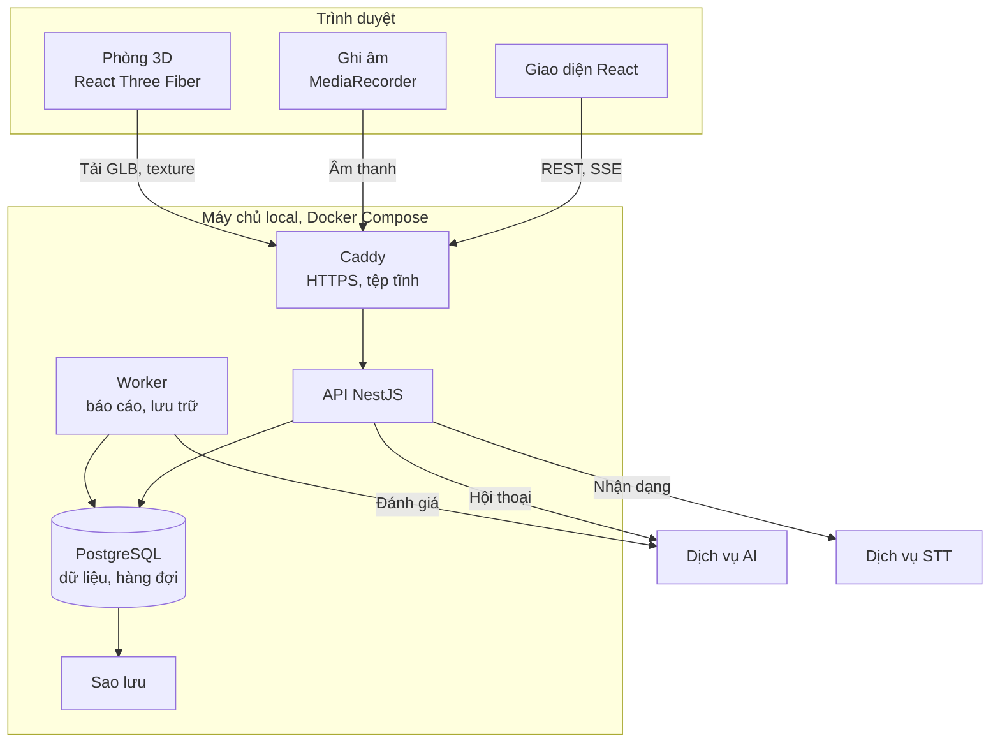

# 06. Đề xuất công nghệ

Tài liệu gốc cho phép nhóm IT đề xuất công nghệ nếu giải thích được ưu điểm, chi phí và rủi ro. Đề xuất này chỉ áp dụng cho phần web 3D. Lựa chọn công nghệ AI và nhận dạng giọng nói thuộc về đầu mối AI/giọng nói.

## 1. Tóm tắt đề xuất

| Lớp | Lựa chọn | Lý do chính |
|---|---|---|
| Frontend | React, TypeScript, Vite | Ứng dụng sau đăng nhập, không cần SEO, build ra tệp tĩnh dễ chạy local |
| 3D | Three.js qua React Three Fiber, WebGL 2 | Dùng chung trạng thái với giao diện React, nhẹ, có hướng đi tới WebXR |
| Backend | NestJS (Node.js, TypeScript) | Cùng ngôn ngữ với frontend, có sẵn cấu trúc module và phân quyền |
| Cơ sở dữ liệu | PostgreSQL | Dữ liệu quan hệ rõ ràng, có JSONB cho hồ sơ ca |
| Hàng đợi | pg-boss, chạy trên PostgreSQL | Không phải vận hành thêm Redis |
| Hội thoại thời gian thực | REST và SSE | Tự kết nối lại, khớp yêu cầu không đứt quãng |
| Triển khai | Docker Compose, Caddy | Khởi động bằng một lệnh, HTTPS tự động |

Toàn bộ là phần mềm mã nguồn mở, không phát sinh phí bản quyền.

## 2. Kiến trúc



Nguyên tắc:

1. **Trình duyệt không gọi trực tiếp dịch vụ AI hay STT.** Mọi lời gọi đi qua backend để giữ khóa bí mật, kiểm soát quyền, giới hạn tần suất và ghi nhận mức dùng.
2. **Phòng 3D chỉ là lớp hiển thị.** Hội thoại không phụ thuộc phòng 3D, nên 3D lỗi thì phiên vẫn tiếp tục.
3. **Backend giữ trạng thái phiên.** Dịch vụ AI không cần lưu trạng thái, nên có thể thay hoặc khởi động lại mà không mất phiên.
4. **Lớp kết nối AI và STT là adapter thay được.** Có bản giả lập để phát triển độc lập.

## 3. Frontend

| Hạng mục | Lựa chọn | Ghi chú |
|---|---|---|
| Khung ứng dụng | React 19.3, TypeScript 6.0, Vite 8 | SPA, build ra tệp tĩnh do Caddy phục vụ |
| Định tuyến | React Router | Tách gói theo trang, trang ngoài phòng 3D không tải Three.js |
| Dữ liệu từ máy chủ | TanStack Query 5 | Cache, thử lại, trạng thái tải và lỗi |
| Trạng thái cục bộ | Zustand 5 | Cầu nối giữa hội thoại và phòng 3D |
| Giao diện | Tailwind CSS 4, shadcn/ui | Thành phần dựa trên Radix, hỗ trợ bàn phím tốt |
| Biểu mẫu | React Hook Form, Zod 4 | Lược đồ Zod dùng chung với backend |
| Ghi âm | MediaRecorder API | Chọn định dạng bằng `isTypeSupported` |

**Vì sao không dùng Next.js:** ứng dụng nằm sau đăng nhập nên không được lợi từ SSR, trong khi Canvas 3D vẫn phải chạy ở trình duyệt. SPA build tĩnh giảm một tiến trình phải vận hành trên máy chủ local.

## 4. Phòng 3D

### 4.1. Thư viện

| Thư viện | Phiên bản | Ghi chú |
|---|---|---|
| `three` | 0.186.1, ghim chính xác | Dòng 0.x có thể đổi API giữa các bản |
| `@react-three/fiber` | 9.8 | Yêu cầu React thấp hơn 19.4 |
| `@react-three/drei` | 10.7 | `useGLTF`, `useAnimations`, `PerformanceMonitor` |
| `@gltf-transform/cli` | 4.5 | Nén tài sản 3D lúc build |
| `@react-three/xr` | 6.6 | Chưa cài. Dùng khi mở rộng VR |

**Dùng `WebGLRenderer` (WebGL 2), chưa dùng WebGPU.** Tài liệu Three.js cho biết `WebGLRenderer` vẫn được duy trì và là lựa chọn khuyến nghị cho ứng dụng WebGL 2 thuần. Cảnh của dự án đơn giản nên không cần WebGPU, trong khi độ phủ trên điện thoại và phần WebXR về sau mới là điều quan trọng.

### 4.2. Thiết kế cảnh

- Một phòng tham vấn dùng chung. Mỗi ca chọn một nhân vật qua `avatar_key`.
- Camera đặt cố định ở vị trí ghế người tham vấn, chỉ xoay tại chỗ trong giới hạn góc. Đáp ứng "điều khiển góc nhìn cơ bản" mà không cần di chuyển trong phòng.
- Ánh sáng nướng sẵn vào texture, không dùng bóng đổ thời gian thực. Đây là cách giảm tải hiệu quả nhất trên điện thoại.
- Giới hạn độ phân giải vẽ ở điện thoại và dừng vẽ khi tab bị ẩn để tiết kiệm pin.
- Vì AI không phát tiếng nên không cần khớp môi. Nhân vật chỉ cần hoạt ảnh thân trên, nhịp thở, chớp mắt và tư thế theo cảm xúc.

### 4.3. Tách biệt với hội thoại

```text
Hội thoại (React DOM)  --->  store Zustand  --->  Phòng 3D (Canvas)
  trạng thái phiên             emotion               chọn hoạt ảnh
  lời thân chủ                 state                 chuyển tư thế
```

Canvas nằm trong error boundary riêng và được tải trễ. Nếu Canvas lỗi hoặc thiết bị mất ngữ cảnh WebGL, giao diện đổi sang ảnh 2D còn hội thoại không bị ảnh hưởng (FR-3D-08, NFR-REL-06). `PerformanceMonitor` theo dõi tốc độ khung hình để giảm chất lượng trước, sau đó mới đề xuất chế độ nhẹ.

### 4.4. Quy trình tài sản 3D

1. Dựng phòng và nhân vật trong Blender.
2. Xuất GLB, nén hình học bằng Meshopt, nén texture sang KTX2 bằng `gltf-transform`.
3. Lưu tệp nguồn bằng Git LFS, tệp build có mã băm trong tên để cache lâu dài.

Nguồn nhân vật gợi ý: MPFB (MakeHuman cho Blender) cho nhân vật và Mixamo cho hoạt ảnh. Các nguồn tham khảo cho biết đầu ra MakeHuman theo CC0 và Mixamo cho phép dùng thương mại miễn phí nhưng không phân phối lại như tài sản rời. Đây là nguồn thứ cấp, nên cần đọc điều khoản chính thức trước khi dùng (OI-10). Nhân vật nên trông như người Việt Nam và không theo phong cách hoạt hình.

Lưu ý về chạy offline: một số helper của drei mặc định tải bộ giải nén từ CDN bên ngoài. Phải đặt đường dẫn giải nén về tệp tự lưu trữ, nếu không phòng 3D sẽ không tải được trên mạng không có internet (NFR-COMP-05).

## 5. Backend

| Hạng mục | Lựa chọn | Ghi chú |
|---|---|---|
| Runtime | Node.js 24 LTS | Được hỗ trợ đến 30/04/2028. Node 26 mới vào LTS ngày 28/10/2026 nên chưa cần dùng |
| Khung | NestJS 12 | Module, guard phân quyền, `@nestjs/swagger` sinh OpenAPI |
| ORM | Prisma 7.10 | Migration có phiên bản, kiểu dữ liệu an toàn |
| Hàng đợi | pg-boss 12 | Báo cáo, tác vụ lưu trữ hằng ngày |
| Xác thực | Phiên trong CSDL, cookie `HttpOnly`, Argon2id | Thu hồi được ngay khi khóa tài khoản |
| Giới hạn tần suất | `@nestjs/throttler` | Bộ nhớ trong là đủ với một tiến trình API |
| Log | Pino | JSON có cấu trúc, che trường nhạy cảm |

Lưu ý phiên bản:

- **Prisma:** thẻ `latest` trên npm tại ngày kiểm tra đang trỏ tới `8.0.0-rc.28`, là bản thử nghiệm. Phải ghim dòng 7.10, không cài theo `latest`.
- **TypeScript:** npm đã có 7.0, nhưng `@nestjs/cli` hiện đi kèm `~6.0.2`. Dùng 6.0 cho toàn dự án đến khi NestJS xác nhận hỗ trợ 7.

### 5.1. Module

| Module | Trách nhiệm |
|---|---|
| `auth` | Đăng nhập, phiên đăng nhập, guard phân quyền |
| `users`, `classes` | Tài khoản, lớp |
| `cases` | Ca, phiên bản, kiểm tra hồ sơ |
| `assignments` | Giao bài, nộp bài |
| `sessions` | Vòng đời phiên, khôi phục, luồng SSE |
| `conversation` | Xử lý lượt, chống trùng, gọi AI |
| `speech` | Nhận âm thanh, chuyển tiếp sang STT |
| `assessment` | Tạo báo cáo, kiểm tra dẫn chứng, nhận xét giảng viên |
| `reflection` | Phản tư |
| `safety` | Sự kiện an toàn |
| `retention` | Trạng thái bản ghi, tác vụ định kỳ |
| `ai-gateway` | Adapter AI và STT: `mock`, `http` |
| `audit`, `admin` | Nhật ký, cấu hình, trạng thái dịch vụ |

### 5.2. Hội thoại: REST và SSE

Sinh viên gửi lượt bằng `POST`, phản hồi đẩy về qua Server-Sent Events.

| Hướng | Điểm cuối | Vai trò |
|---|---|---|
| Lên | `POST /api/sessions/:id/turns` | Gửi lượt, kèm `clientTurnId` để chống trùng |
| Lên | `POST /api/sessions/:id/speech` | Gửi âm thanh, nhận văn bản nhận dạng |
| Xuống | `GET /api/sessions/:id/events` | Luồng SSE: từng phần phản hồi, kết thúc lượt, tín hiệu an toàn |

**Vì sao chọn SSE thay vì WebSocket:** luồng thời gian thực ở đây chỉ có một chiều, vì AI trả về văn bản. SSE có cơ chế `Last-Event-ID`, nên kết nối lại và bù sự kiện đã lỡ khớp thẳng với FR-SES-06. SSE chạy trên HTTP thông thường nên dễ qua proxy, và dùng được cookie đăng nhập có sẵn. Caddy phục vụ HTTP/2 nên không gặp giới hạn số kết nối của trình duyệt. Nếu sau này cần gửi âm thanh theo luồng hoặc AI nói được, có thể bổ sung WebSocket cho riêng phần đó.

### 5.3. Giọng nói phía trình duyệt

- Âm thanh được ghi xong rồi mới gửi lên. Đây là cách đơn giản và ổn định nhất cho thao tác nhấn để nói.
- Định dạng chọn theo thứ tự `audio/webm;codecs=opus`, rồi `audio/mp4`, vì Safari phiên bản cũ không hỗ trợ WebM. Dịch vụ STT cần nhận được cả hai (xem tài liệu 07).
- Trên iOS, việc ghi âm phải bắt đầu từ thao tác của người dùng.

## 6. Cơ sở dữ liệu

| Hạng mục | Lựa chọn | Ghi chú |
|---|---|---|
| CSDL | PostgreSQL 18 | Hỗ trợ đến 14/11/2030 |
| Dữ liệu linh hoạt | JSONB | Hồ sơ ca, rubric, trạng thái thân chủ |
| Hàng đợi | pg-boss, schema riêng | Không cần Redis |
| Lọc xóa mềm | Prisma client extension dùng chung | Mọi truy vấn của sinh viên và giảng viên đi qua một chỗ |
| Chỉ mục | Theo (`record_status`, `retention_until`) và (`session_id`, `seq`) | Phục vụ tác vụ lưu trữ và đọc transcript |
| Sao lưu | `pg_dump` hằng ngày sang ổ đĩa khác | Xem NFR-BAK |

**Vì sao chỉ một CSDL:** với 50 người dùng, PostgreSQL đủ sức làm cả kho dữ liệu, kho phiên đăng nhập và hàng đợi. Mỗi dịch vụ bớt đi là bớt một thứ cần cài, sao lưu và theo dõi trên máy chủ local. Chỉ thêm Redis khi chạy nhiều tiến trình API.

**Không cần object storage:** hệ thống không lưu âm thanh, còn tài sản 3D đi kèm bản build.

## 7. Triển khai local

| Dịch vụ | Vai trò |
|---|---|
| `caddy` | HTTPS, HTTP/2, phục vụ frontend và tài sản 3D, chuyển tiếp `/api` |
| `api` | API NestJS |
| `worker` | Cùng mã nguồn với API, chạy tác vụ nền |
| `postgres` | Cơ sở dữ liệu, không mở cổng ra ngoài |
| `backup` | Sao lưu định kỳ sang ổ đĩa khác |
| `uptime-kuma` | Theo dõi dịch vụ và cảnh báo |

Môi trường thử nghiệm và chính thức dùng hai bộ Compose tách biệt dữ liệu.

### 7.1. HTTPS trên mạng nội bộ

Đây là điểm dễ bỏ sót nhất của phương án chạy local. Trình duyệt chỉ cho dùng `getUserMedia` trong ngữ cảnh an toàn. Mở trang qua `http://192.168.x.x` thì `navigator.mediaDevices` không tồn tại và tính năng giọng nói không chạy trên iPad hay điện thoại, dù vẫn chạy được khi lập trình viên thử ở `localhost`.

| Phương án | Cách làm | Đánh giá |
|---|---|---|
| A. Tên miền thật, chứng chỉ Let's Encrypt qua DNS-01 | Mua tên miền, trỏ về IP nội bộ, Caddy tự gia hạn | **Đề xuất.** Thiết bị của sinh viên không phải cài gì |
| B. CA nội bộ (Caddy `tls internal`, mkcert) | Cài chứng chỉ gốc lên từng thiết bị | Dùng khi máy chủ hoàn toàn không có internet. Khó làm trên thiết bị cá nhân |

Với phương án A, máy chủ cần ra internet để gia hạn chứng chỉ, và một số router chặn bản ghi DNS trỏ về IP nội bộ. Nếu gặp, chạy DNS nội bộ cho tên miền đó. Việc chọn phương án phụ thuộc OI-04.

### 7.2. Cấu hình máy chủ ước tính

Áp dụng cho phần web, không tính dịch vụ AI và STT: 4 vCPU, 8 GB RAM, SSD 100 GB, một ổ đĩa riêng cho sao lưu, nên có UPS. Đây là ước tính cần kiểm chứng bằng thử tải (OI-13). Nếu mô hình AI chạy trên cùng máy, nhu cầu phần cứng sẽ do đầu mối AI xác định và thường cần GPU.

## 8. Tổ chức mã nguồn

```text
web3D/
  apps/
    web/              React, phòng 3D
    api/              NestJS, gồm điểm khởi động cho API và worker
  packages/
    shared/           Lược đồ Zod, kiểu dữ liệu dùng chung
  assets/3d/          Tệp nguồn 3D, Git LFS
  deploy/             Docker Compose, Caddyfile, script sao lưu
  docs/srs/           Bộ tài liệu này
```

Dùng pnpm workspace để chia sẻ kiểu dữ liệu giữa frontend và backend.

## 9. Kiểm thử

| Cấp | Công cụ | Phạm vi |
|---|---|---|
| Đơn vị | Vitest 5 | Logic backend, phân quyền, kiểm tra dẫn chứng, quy tắc trạng thái |
| Thành phần | Testing Library | Trạng thái giao diện hội thoại |
| Tích hợp | Vitest, PostgreSQL trong Docker | API, chống trùng lượt, khôi phục phiên |
| Đầu cuối | Playwright 1.64 | Luồng chính trên Chromium, Firefox, WebKit, kèm mất mạng giả lập |
| Thiết bị thật | Kiểm thử thủ công | Micro và phòng 3D trên iPhone, iPad, Android |
| Tải | k6 | 50 phiên đồng thời với AI giả lập |

## 10. Các phương án đã cân nhắc

| Hạng mục | Phương án khác | Vì sao không chọn |
|---|---|---|
| 3D | Babylon.js | Rất tốt, nhưng tách khỏi mô hình thành phần React và gói lớn hơn mức cần cho một phòng |
| 3D | Unity WebGL | Gói tải nặng, kém trên điện thoại, không hợp với giao diện web |
| 3D | PlayCanvas | Ưu điểm nằm ở trình soạn thảo trên đám mây, không hợp với chạy local |
| Frontend | Next.js | Xem mục 3 |
| Backend | FastAPI | Hợp lý nếu đội mạnh Python, nhưng mất lợi thế dùng chung kiểu với frontend. Dịch vụ AI vẫn viết bằng Python được vì giao tiếp qua HTTP |
| Backend | Spring Boot | Nặng hơn mức cần cho 50 người dùng |
| CSDL | MongoDB | Dữ liệu chủ yếu là quan hệ, phân quyền và thống kê cần truy vấn liên kết |
| CSDL | MySQL | Dùng được, nhưng JSONB của PostgreSQL và hàng đợi pg-boss là lợi thế rõ ràng |
| ORM | Drizzle | Tốt, nhưng dòng 1.0 vẫn đang ở bản beta |
| Thời gian thực | WebSocket, Socket.IO | Xem mục 5.2 |

## 11. Phiên bản đã kiểm tra

Kiểm tra ngày 30/10/2026 từ npm registry, lịch phát hành Node.js và `postgresql.org`. Các phiên bản được ghim trong tệp lock khi khởi tạo dự án.

| Thành phần | Phiên bản đề xuất | Ghi chú |
|---|---|---|
| Node.js | 24 LTS | Máy phát triển hiện có 24.10.0 |
| TypeScript | 6.0 | Theo `@nestjs/cli` |
| React | 19.3 | Không nâng lên 19.4 trước khi Fiber hỗ trợ |
| Vite | 8.3 | |
| Three.js | 0.186.1 | 0.187.0 mới phát hành đúng ngày kiểm tra, nên chờ ổn định |
| @react-three/fiber | 9.8 | |
| @react-three/drei | 10.7 | |
| NestJS | 12.3 | |
| Prisma | 7.10 | Không dùng `latest` |
| pg-boss | 12.38 | Yêu cầu Node 22.12 trở lên |
| PostgreSQL | 18 | |
| Tailwind CSS | 4.3 | |
| TanStack Query | 5 | |
| Zustand | 5 | |
| Zod | 4 | |

## 12. Nguồn tham khảo

- [MDN: MediaDevices.getUserMedia()](https://developer.mozilla.org/en-US/docs/Web/API/MediaDevices/getUserMedia)
- [Three.js Manual: WebGPURenderer](https://threejs.org/manual/en/webgpurenderer)
- [WebKit: MediaRecorder API](https://webkit.org/blog/11353/mediarecorder-api/)
- [TestMu AI: MediaRecorder browser compatibility](https://www.testmuai.com/web-technologies/mediarecorder/)
- [Node.js Release schedule](https://raw.githubusercontent.com/nodejs/Release/main/schedule.json)
- [PostgreSQL versions](https://www.postgresql.org/versions.json)
- [Cinevva: Free character animations and rigging](https://app.cinevva.com/guides/free-character-animations-rigging)
- [openSUSE: MakeHuman package](https://build.opensuse.org/package/show/graphics/makehuman)
